# Free 3D mockup templates (GLB)

**18 blank product models for mockups — boxes, cans, bottles, cups, mugs, bags, signs, a truck
and an ambulance — as glTF binary (`.glb`) files. Free for any use, including commercial.**

Every model is true to size in metres, has named parts (the mug is `Body`, `Inside` and `Handle`) and UVs on every part,
so you can drop it into Blender, three.js, Babylon.js, Unity, Unreal or any glTF viewer and put your
own artwork on it.

> **Want your logo on it without any 3D software?** Each model has an *Open with your logo* link that
> opens it in [TheMark Studio](https://themarkstudio.online) — a free browser tool: add your logo, colours and text, turn it
> to any angle, download a picture or a 3D file. No sign-up, nothing uploaded.

The pictures show each model with a sample logo, as it looks in the Studio.

### Packaging

| Preview | Model | Size | File | Brand it |
|---|---|---|---|---|
| 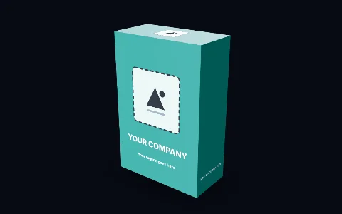 | **Retail box**<br>Product carton<br><sub>12 triangles</sub> | Width 120 mm · Height 180 mm · Depth 60 mm | [`retail-box.glb`](models/retail-box.glb) (2 KB) | [Open with your logo →](https://themarkstudio.online/?template=retail-box) |
| 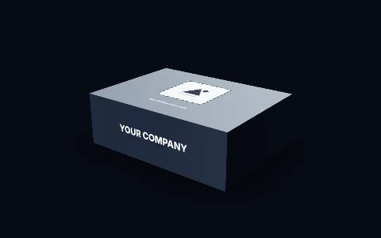 | **Mailer box**<br>Shipping mailer box<br><sub>12 triangles</sub> | Width 300 mm · Height 100 mm · Depth 220 mm | [`mailer-box.glb`](models/mailer-box.glb) (2 KB) | [Open with your logo →](https://themarkstudio.online/?template=mailer-box) |
| 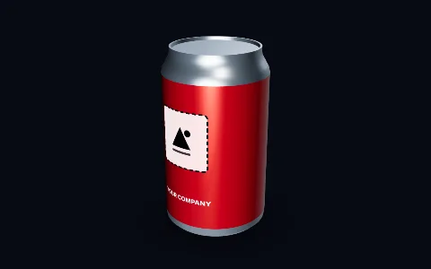 | **Drinks can**<br>330 ml aluminium can<br><sub>7,168 triangles</sub> | Diameter 66 mm · Height 115 mm | [`drinks-can.glb`](models/drinks-can.glb) (217 KB) | [Open with your logo →](https://themarkstudio.online/?template=drinks-can) |
|  | **Glass bottle**<br>Beverage bottle with a cap<br><sub>12,864 triangles</sub> | Diameter 70 mm · Height 240 mm | [`glass-bottle.glb`](models/glass-bottle.glb) (373 KB) | [Open with your logo →](https://themarkstudio.online/?template=glass-bottle) |
| 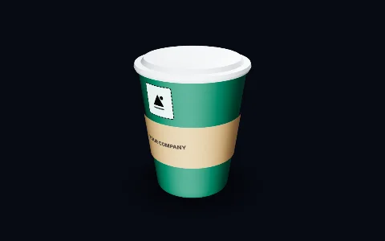 | **Coffee cup**<br>Takeaway cup with sleeve and lid<br><sub>7,040 triangles</sub> | Top diameter 90 mm · Height 110 mm | [`coffee-cup.glb`](models/coffee-cup.glb) (218 KB) | [Open with your logo →](https://themarkstudio.online/?template=coffee-cup) |
| 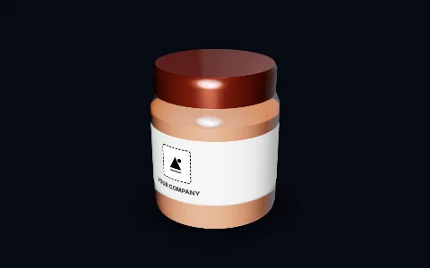 | **Glass jar**<br>Preserve jar with lid<br><sub>7,488 triangles</sub> | Diameter 85 mm · Height 100 mm | [`glass-jar.glb`](models/glass-jar.glb) (228 KB) | [Open with your logo →](https://themarkstudio.online/?template=glass-jar) |
| 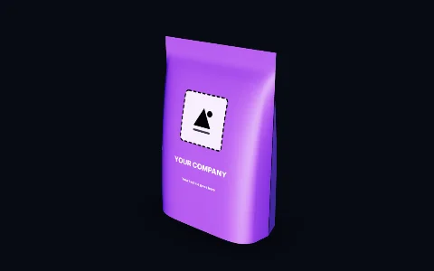 | **Stand-up pouch**<br>Flexible stand-up pouch<br><sub>4,088 triangles</sub> | Width 160 mm · Height 230 mm · Gusset 80 mm | [`stand-up-pouch.glb`](models/stand-up-pouch.glb) (118 KB) | [Open with your logo →](https://themarkstudio.online/?template=stand-up-pouch) |

### Merch

| Preview | Model | Size | File | Brand it |
|---|---|---|---|---|
| 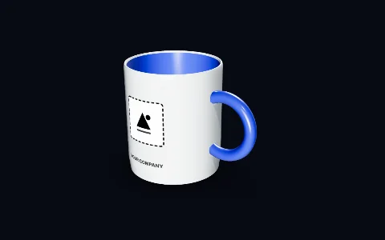 | **Mug**<br>Ceramic mug<br><sub>9,792 triangles</sub> | Diameter 82 mm · Height 95 mm | [`mug.glb`](models/mug.glb) (291 KB) | [Open with your logo →](https://themarkstudio.online/?template=mug) |
| 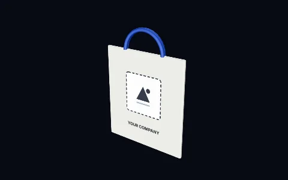 | **Tote bag**<br>Canvas tote bag<br><sub>2,892 triangles</sub> | Width 380 mm · Height 420 mm | [`tote-bag.glb`](models/tote-bag.glb) (161 KB) | [Open with your logo →](https://themarkstudio.online/?template=tote-bag) |
| 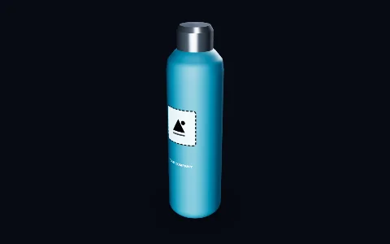 | **Water bottle**<br>Insulated steel bottle<br><sub>11,456 triangles</sub> | Diameter 73 mm · Height 260 mm | [`water-bottle.glb`](models/water-bottle.glb) (333 KB) | [Open with your logo →](https://themarkstudio.online/?template=water-bottle) |

### Signs

| Preview | Model | Size | File | Brand it |
|---|---|---|---|---|
| 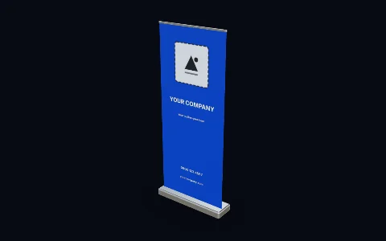 | **Roll-up banner**<br>Event roll-up banner<br><sub>3,108 triangles</sub> | Width 850 mm · Height 2000 mm | [`rollup-banner.glb`](models/rollup-banner.glb) (321 KB) | [Open with your logo →](https://themarkstudio.online/?template=rollup-banner) |
| 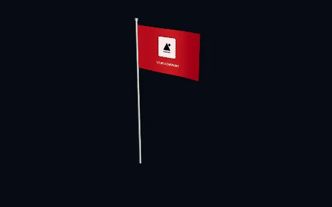 | **Flag**<br>Pole flag<br><sub>1,600 triangles</sub> | Width 1500 mm · Height 900 mm | [`flag.glb`](models/flag.glb) (60 KB) | [Open with your logo →](https://themarkstudio.online/?template=flag) |
| 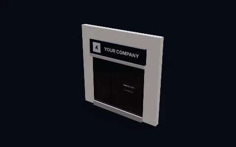 | **Storefront sign**<br>Shop fascia sign with windows<br><sub>8,748 triangles</sub> | Sign width 3000 mm · Sign height 700 mm | [`storefront-sign.glb`](models/storefront-sign.glb) (928 KB) | [Open with your logo →](https://themarkstudio.online/?template=storefront-sign) |
| 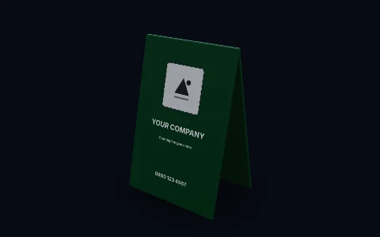 | **A-frame sign**<br>Pavement A-frame sign<br><sub>1,944 triangles</sub> | Width 600 mm · Height 900 mm | [`a-frame-sign.glb`](models/a-frame-sign.glb) (206 KB) | [Open with your logo →](https://themarkstudio.online/?template=a-frame-sign) |

### Devices

| Preview | Model | Size | File | Brand it |
|---|---|---|---|---|
| 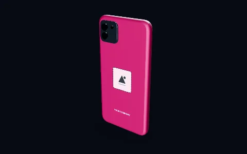 | **Phone case**<br>Phone case with camera bump<br><sub>1,784 triangles</sub> | Width 75 mm · Height 150 mm · Thickness 10 mm | [`phone-case.glb`](models/phone-case.glb) (72 KB) | [Open with your logo →](https://themarkstudio.online/?template=phone-case) |
|  | **Laptop lid**<br>Laptop (lid branding area)<br><sub>1,400 triangles</sub> | Width 310 mm · Depth 220 mm | [`laptop.glb`](models/laptop.glb) (48 KB) | [Open with your logo →](https://themarkstudio.online/?template=laptop) |

### Vehicles

| Preview | Model | Size | File | Brand it |
|---|---|---|---|---|
| 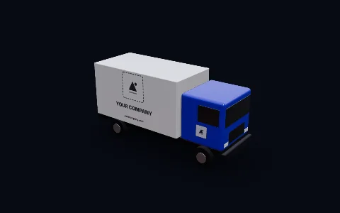 | **Box truck**<br>Box truck (7 m)<br><sub>11,716 triangles</sub> | — | [`box-truck.glb`](models/box-truck.glb) (1.2 MB) | [Open with your logo →](https://themarkstudio.online/?template=box-truck) |
| 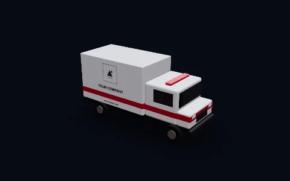 | **Ambulance**<br>Box ambulance<br><sub>13,684 triangles</sub> | — | [`ambulance.glb`](models/ambulance.glb) (1.4 MB) | [Open with your logo →](https://themarkstudio.online/?template=ambulance) |

## Using the models

**Blender** — *File → Import → glTF 2.0 (.glb/.gltf)*.

**three.js**

```js
import { GLTFLoader } from "three/addons/loaders/GLTFLoader.js";

new GLTFLoader().load("models/mug.glb", (gltf) => scene.add(gltf.scene));
```

**On a web page** with [`<model-viewer>`](https://modelviewer.dev):

```html
<script type="module" src="https://ajax.googleapis.com/ajax/libs/model-viewer/4.0.0/model-viewer.min.js"></script>
<model-viewer src="models/drinks-can.glb" camera-controls auto-rotate></model-viewer>
```

## Licence

[CC0 1.0](https://creativecommons.org/publicdomain/zero/1.0/) — public domain. Use, change and sell
what you make with them, no credit required. A link back to [TheMark Studio](https://themarkstudio.online) is appreciated.

These are generic products. The brands you put on them are your responsibility: only use logos you
own or have permission to use.

## More

- Make a mockup in your browser: [themarkstudio.online](https://themarkstudio.online)
- Free 3D models, textures and tools for mockups: [awesome-3d-mockups](https://github.com/themarkstudio/awesome-3d-mockups)
- Found a problem with a model? [Open an issue](../../issues).

`templates.json` lists every model with its size, triangle count and file size.
